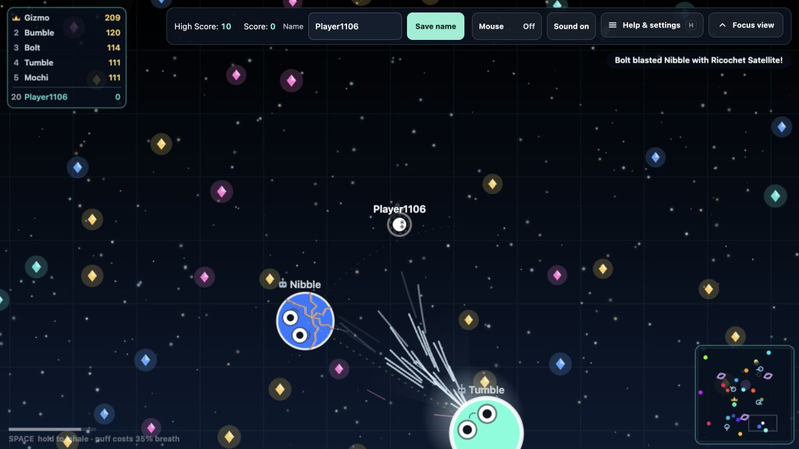

# Ascend Avoid

[Play Ascend Avoid](https://ascend.drewclark.io/) — a real-time multiplayer creature arena built with TypeScript, Canvas 2D, and Colyseus. Collect gems, grow, steal from injured rivals, assemble weapons, and fire captured players as living cannonballs.



*Actual gameplay captured from the local desktop build, with bot rivals.*

The server owns movement, collisions, damage, gem accounting, and capture rules. The browser predicts movement and renders the arena. Public matches and private practice lessons use the same gameplay systems. Rooms live in memory; no database or other local service is required.

Gem losses reduce current physical growth, including at maximum size. Overflow gems remain transferable wealth; only newly collected or earned gems can rebuild lost growth. The existing growth curve and physical size limit still apply. See [growth accounting](docs/GROWTH_ACCOUNTING.md) for the local implementation and checks.

## Controls and practice

| Action | Desktop | Phone / tablet |
| --- | --- | --- |
| Move | WASD, arrow keys, or enabled mouse-follow | Left joystick |
| Aim | Mouse or movement direction | Drag the right action control |
| Inhale | Hold Space | Hold the action control |
| Puff / fire a captive | Tap Space; release the capture input before firing | Tap the action control; release after capture first |
| Deploy an assembled weapon | E or Place weapon | Place weapon |
| Help and settings | H or the menu | Menu button |

The action control changes its label with the current state. Capture smaller healthy rivals, release, aim, then fire; holding too long ejects them. Cracked players must retreat while their breathing is blocked. Ordinary movement slides safely around black holes; being fired into a core is dangerous. Weapons are assembled from matching parts, and carried parts can be stolen.

**Help & settings → Practice / Tutorials** offers five lessons: movement/capture, aimed combat, escape/recovery, black-hole shots, and weapon assembly. The menu also contains sound and mouse preferences, recent activity, weapon credit, and a scan-to-play QR code.

Current mechanics and tuning are documented in [Game design](docs/GAME_DESIGN.md). The short in-game instructions come from [GameRules.ts](src/ui/GameRules.ts). Older study documents and playtest reports describe historical experiments and are not necessarily current rules.

## Run locally

Use **Node.js 20+ and npm**. Install the client/build dependencies and the independent server dependencies:

```sh
npm ci
npm ci --prefix server
npm run dev
```

Open **http://localhost:5173/**. Vite serves the client on port 5173 and the game server runs on port 3000. The development command clears those two ports before starting; its client and server processes stop together.

To run the built application instead:

```sh
npm run build
npm run start:prod
```

Open **http://localhost:3000/**. On macOS/Linux, the familiar port-3001 preview is:

```sh
PORT=3001 npm run start:prod
```

In PowerShell, set `$env:PORT = '3001'` before `npm run start:prod`. Rebuild after editing source when using this compiled preview; it does not hot-reload.

The retained single-player fallback handles online initialization errors. A normal network disconnect retries the online connection; it does not silently switch modes.

## Verification

Run the main checks after making changes:

```sh
npm run type-check
npm run lint
node scripts/gen-synced-types.mjs --check
npm test
npm run build
```

`npm test` runs the TypeScript unit suites, practice-progress checks, and real-network multiplayer scenarios. The production server build follows its runtime entry point and omits tests, declarations, and source maps. The normal type check still includes test source. `npm run build` also runs `verify:production` to check the emitted package and resolve its imports.

Install Playwright's local browser binaries once:

```sh
npx playwright install chromium firefox webkit
```

For browser tests against an isolated local test server, build first, then run on macOS/Linux:

```sh
E2E_START_SERVER=1 E2E_TEST_HOOKS=1 E2E_URL=http://127.0.0.1:3002 npm run test:browsers
```

PowerShell equivalent:

```powershell
$env:E2E_START_SERVER = '1'
$env:E2E_TEST_HOOKS = '1'
$env:E2E_URL = 'http://127.0.0.1:3002'
npm run test:browsers
```

The test harness starts the compiled server on port 3002. Tests requiring fixtures need `E2E_TEST_HOOKS=1` and a non-production server. Production rejects those test commands. **Without `E2E_URL`, browser tests target the live website**, so prefer the isolated command for development.

Pull request CI checks desktop Firefox with Playwright and runs Mozilla's Android Firefox app on an Android emulator. Both join an isolated game; the Android check also verifies the mobile Canvas renderer. The Playwright Firefox phone profiles exercise desktop Gecko with touch and phone-sized viewports. Neither viewport emulation nor an Android emulator measures frame pacing, battery use or touch latency on a real phone. The wider Linux Chrome and WebKit matrix remains deferred.

For private tutorial playthroughs and Android website metadata checks against a running local **production** build, enable their explicit release flags:

```sh
PRACTICE_E2E=1 ANDROID_E2E=1 E2E_URL=http://localhost:3000 npx playwright test tests/e2e/practice.spec.mjs tests/e2e/five-lessons.spec.mjs tests/e2e/android-package.spec.mjs
```

These tests use ordinary lesson controls and public app metadata, without enabling production test hooks. Some long-running or device-specific cases have their own opt-in conditions.

Simulation and research tools remain available under `scripts/`, including `npm run sim:bots`, `npm run sim:crowd`, and `node scripts/capture-balance.cjs 100`. Their output can establish mechanical behavior, not human balance or real-device performance.

## Docker and deployment

```sh
docker build -t ascend-avoid:local .
docker run --rm -p 3000:3000 ascend-avoid:local
```

The final image runs as a non-root user and contains the built client, compiled runtime server, and production server dependencies. Client/build tooling and compiled tests stay out of the runtime image. `/health` reports server health. The compiled-package check is also available separately with `npm run verify:production`.

Pull requests run the checks in [ci.yml](.github/workflows/ci.yml). A push to `main` triggers [deploy.yml](.github/workflows/deploy.yml), which checks the code, publishes a commit-tagged image, and updates the production Azure Container App. [staging.yml](.github/workflows/staging.yml) tests a selected commit on the separate staging app. Keep branch work local or in a PR until a release is intended.

## Configuration

| Variable | Default / purpose |
| --- | --- |
| `PORT` | `3000`; HTTP and WebSocket port |
| `NODE_ENV` | Set to `production` for the deployed server; production disables test hooks and the Colyseus monitor |
| `APP_ENV` | Set to `staging` to serve the Test app's website association file |
| `CORS_ORIGINS` | Comma-separated HTTP origins; defaults to the production site and the two port-5173 localhost origins |
| `LOG_LEVEL` | `info`; also accepts `error`, `warn`, or `debug` |
| `PING_INTERVAL`, `PING_MAX_RETRIES` | WebSocket heartbeat settings; defaults are `5000` milliseconds and `3` retries |
| `MONITOR_PATH` | `/colyseus`; available only outside production |

The built client uses the page's origin for HTTP/WebSocket play. The Vite development client connects to the local server on port 3000. No credentials belong in browser configuration or source control.

## Web icons and Android apps

The supplied web artwork is preserved in [branding/web/ascend-avoid-favicon-pack](branding/web/ascend-avoid-favicon-pack/). Browser favicon, Apple bookmark, and PWA standard icons are copied to `public/`. Synchronize them with:

```sh
npm run icons:sync
```

That command also regenerates the existing maskable-specific image from `public/favicon.svg`; the supplied PNGs are not labeled as maskable. Native Android launcher artwork is managed separately under `android/branding/` and the target resource directories.

The Android project is a Trusted Web Activity wrapper around the hosted game. **Ascend Avoid** opens production; **Ascend Avoid Test** has a separate package ID and opens staging. Both can be installed together. The checked-in build/install helpers currently target Windows with PowerShell 7:

```powershell
npm run android:setup -- -AcceptLicenses
npm run android:build
npm run android:verify
npm run android:test:build
npm run android:test:verify
```

Builds produce APK/AAB artifacts under `artifacts/android/`, with Test artifacts under `artifacts/android/test/`. Wi-Fi pairing/install commands are `android:devices`, `android:pair`, `android:phone`, and `android:test:phone`. `android:backup` creates a verified, encrypted signing-key backup. Keep signing material, passwords, machine configuration, and generated artifacts out of Git.

See [Android release setup](docs/ANDROID_RELEASE.md) and [the testing workflow](docs/ANDROID_TESTING_WORKFLOW.md) for signing, website association, installation, and remaining device/Play Console checks. Native launcher changes require checking both targets; a passing web browser test does not validate an APK.

## Code map and maintenance

| Location | Responsibility |
| --- | --- |
| `src/core/`, `src/network/` | Client lifecycle, inputs, connection handling, and browser compatibility adapters |
| `src/render/`, `src/ui/`, `src/styles/` | Canvas rendering, menus/controls, and responsive presentation |
| `src/practice/`, `server/practice/` | Private lessons, progress, and scenario control |
| `server/schema/`, `server/systems/`, `server/game/` | Synced state, authoritative simulation, and shared mechanics |
| `server/constants/` | Gameplay and server constants |
| `public/`, `branding/web/` | Served web assets and their supplied source bundle |
| `android/` | Native wrapper, target configuration, and preserved Android branding |
| `tests/e2e/`, `server/tests/`, `scripts/` | Browser tests, unit suites, verification, and research tools |
| `docs/`, `reports/` | Design decisions, follow-up work, and historical evidence |

After changing synced schema fields, run `npm run gen:types` and commit `src/types/synced.ts`. Do not hand-edit generated types or remove neutral compatibility wire slots without a protocol migration. The browser networking adapters are loaded through Vite resolution hooks, so an import-only dead-code scanner can misclassify them. Retain the single-player fallback and the shared sprite/input code it uses.

Start future work from [the current TODO](docs/TODO.md). [The request history](docs/TODO_HISTORY.md), [the early implementation plan](docs/FUN_PASS_PLAN.md), and [the original ten ideas](docs/TOP_10_IDEAS.md) preserve historical decisions and can describe superseded mechanics. Preserve report and branding archives intentionally rather than treating every unimported file as dead code.
