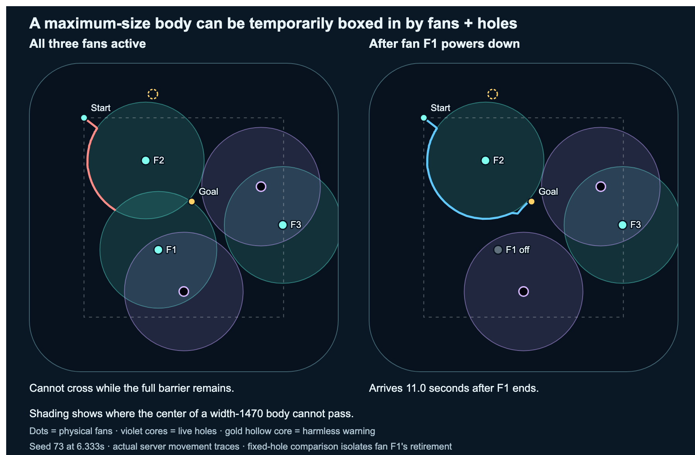
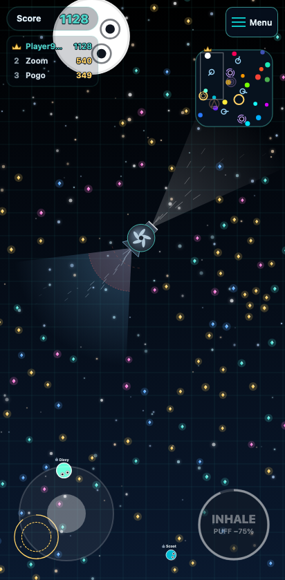

# Overall growth and combat playtest

**Historical baseline assessment.** The player/fan injury gate and persistent
growth fixes were subsequently implemented and approved for release on November
5. See [EARNED_PROJECTILE_INJURY.md](EARNED_PROJECTILE_INJURY.md) and
[GROWTH_ACCOUNTING.md](GROWTH_ACCOUNTING.md). Measurements below retain their
original baseline; the full-layout fan/hole routing finding remains open.

November 4, 2026. Reference release: **9344b16**, PR #84. The user requested a
playtest and findings with **all balance settings retained**. This pass changes
research drivers, evidence and documentation only. It makes no gameplay fix and
does not approve any proposed tuning below.

## Assessment

The strongest next change is to review **which impacts earn injury**, followed
by **giant routes through fans and holes together**. Keep the serious seven-second
injury consequence while assessing the physical significance of its trigger.
The evidence does not justify changing walking speed, puff strength/cost, gem
supply or arena size during this pass.

### 1. Tiny body projectiles can unlock a disproportionately decisive injury

The general player/turbine body-impact path injures on any positive surviving
spill. It does not use the assembled-weapon earned-injury gate. Direct physical
mass resistance can make damage tiny while the full seven-second breathing
block and 450ms stun still apply.

A controlled **100,000-gem, width-1,386** defender illustrates the consequence:

| Trigger | Direct loss | Immediate width | One width-60 pursuer, defender retreats |
| --- | ---: | --- | --- |
| Actual tiny captor firing a standard captive | 138 gems (0.138%) | 1386 → 1385.5 | Run ended in 5/5 repeats, 7.17–7.20s after firing |
| Actual unowned fan launching a width-36 player | 16 gems (0.016%) | Unchanged | Run ended in 5/5 repeats, 6.13s after launch |

These fixtures use a healthy defender, ordinary steering and legal in-range
theft, without walls, extra impacts or other captures. The defender starts
outward movement 300ms after impact; the existing stun remains active. They
are mechanical response controls, not optimal human defense or universal
knockout probabilities. Normal cannon suction recovery is honored; the fan
impact does not provide the same 1.5-second recovery. No-pursuer and stationary
off-range inhale controls transfer **zero** gems.

In the 100k repeats, approximately 80k gems move through ordinary siphoning,
then roughly 19.6k transfer through the existing mouth finish. These are separate
mechanisms; the shooter receives no automatic long-range theft reward.

Two independently replayed populated episodes support that this is not only a
staged possibility:

- A width-56.5 shooter did **91 gems** of damage to an uninjured width-1380.5
  giant holding 95,562 gems. The hit started seven seconds of injury; theft
  notices ending in that window credited **68,321 gems** to three successive
  attackers. It lost the lead before its eventual death.
- A width-24.5 unowned fan passenger did **nine gems** of damage to an uninjured
  width-1410.5 giant. It received the same injury/stun. A larger hit later in
  that window confounds attributing the entire subsequent loss to the tiny hit;
  the initial opening itself is reproduced precisely. Repeated hits did not
  refresh its original injury deadline.

**Recommended follow-up, pending a decision:** make weak body/fan impacts earn a
full injury opening according to physical impact significance. Preserve meaningful
shots, ordinary chip damage and decisive follow-ups. Simply copying the current
nominal-gem injury threshold across every source would retain the late-stock
problem below. No threshold or stun adjustment is selected here.

### 2. Safe holes alone do not guarantee a usable full-layout giant route

At width **1,470**, seed 73 has a clear start and clear goal separated by a
continuous wall–fan–fan–hole–wall barrier. Actual authoritative movement cannot
cross while the fan arrangement remains active. When one fan reaches its normal
retirement, a route opens and the same actor arrives **11.03 seconds later**.



The [vector figure](playtests/overall-balance-routes-2026-11-04.svg) preserves the
geometry for closer inspection.

This is temporary compartmentalization for ordinary walking at a retained body
size. It is not a claim that every giant is trapped, nor a failure of the existing
holes-only route proof. Other sampled routes are usable: all twelve deliberately
routed clear cases arrived in **14.1–43.7 seconds**. Selected detours are
**1.20–2.42 times** the straight-line distance. Several coarse-grid apparent
blockages disappeared with finer geometry or slight natural shrink, so the
confirmed case includes continuous geometry and actual movement controls.

At 50k gems, normal top speed is about **113.2 units/s**; at the cap it is
**109.3**. A long blocked/detoured route can therefore feel like insufficient
walking speed. The present evidence favors checking full-layout placement before
speed changes that could reduce smaller players' existing escape advantage.

**Recommended follow-up, pending a decision:** check combined fan/hole routes
when choosing future landmark locations, with bounded deferral when no useful
route can remain open. Preserve full body collision and safe ordinary hole
walking. Do not silently shrink bodies, pass through housings or enlarge the arena.

Exact coordinates, qualifications, clearances and commands are in
[the giant-navigation investigation](playtests/GIANT_NAVIGATION.md).

### 3. Banked score and physical size diverge near the cap

The uncapped inventory eventually changes far more than the rounded physical
body. Current damage and nominal injury credit still depend on that inventory:

- An equal-body cannon reference hit against **2,000,000 gems** removes **500,000**,
  yet width stays **1470 → 1470**. Speed and immediate size advantage do not change.
- Identical width-1470 bodies at two million and ten million gems take different
  nominal Pinwheel damage (**3,395 vs 7,590**) from a central accepted hit, with
  no displayed shrink in either case. A single hit qualifies for injury again.
- At 100k, a central Pinwheel accepted-hit budget needs two hits in the current
  burst window. At near-cap stocks it can need one. Real trajectories and emitter
  cadence were tested separately from upper-bound accepted-hit budgets.

These are deliberately high-stock stress cases. The natural thirty-minute run
did not approach the physical cap. The manually inspected near-cap browser
encounter also showed injury while its width remained 1469.5.

**Recommended later design review:** keep injury qualification tied to physical
impact power and target resistance; assess how late gem loss should translate
into visible size consequences. A nominal conversion of uncapped gem loss is
not equivalent to physical body damage. This is not approval to raise the cap,
alter the growth curve or select a new damage formula.

## What the ordinary matches establish

Three independent fresh ten-minute arenas peaked at **644–704 width**. The first
actor anywhere in each arena reached width 500 after **310–439 seconds**. These
are fastest arena milestones, not typical newcomer progress. The thirty-minute
seed-11 continuation peaked at **868.5 width / 11,473 gems**, without reaching
width 1000; it repeats the first ten minutes and is not an independent fourth seed.

Across the three fresh arenas there were **75 ordinary-body deaths** and **158
projectile deaths**, with **187 captures and 181 shots**. Spent-ammunition deaths
must stay separate when evaluating how punishing normal body combat is. Leaders
changed, but losing rank before a later defeat means a count of deaths while
ranked first is not a count of all former leaders killed.

All six recipes activated in every case. Mean simultaneous active weapons was
about **0.9**, peaking at three or four; no recipe starvation was observed in
these bot-driven matches. Hole relocation repeatedly succeeded; safety retries
and cancelled warnings sometimes extended a completed rim absence to **20.5s**.
This is a tradeoff to review for predictability, not evidence to remove safety checks.

Two separate **150-second recorded browser runs**, desktop Chrome and emulated
Android Chrome, passed normal connection, camera-bound and population checks
without page errors. They used ordinary inputs and no setup grants. The mobile
script captured/fired twice and deployed two weapons; the desktop script deployed
one weapon. These unseeded routes are not paired device comparisons or uncoached
human trials. The older UI controller also misses offscreen radar guidance,
listens for the obsolete `parry` event and does not always re-arm after injury,
so its action counts cannot establish defense effectiveness or broken controls.
Direct UI inspection additionally covered normal collection, 50k giant movement
and near-cap weapon injury on the current local client.



## Scope and reproducibility

- Six ten-minute authoritative cases: three fresh seeds and three separate
  artificial 20k/50k/100k giant mixes. A thirty-minute continuation and focused
  deterministic replays complement them. Default-disabled traffic, bombs and
  shifting floors remain disabled; fans, gems, weapons and holes retain defaults.
- Controlled current-rule sweeps cover shot follow-ups, healthy escape responses,
  weak body/fan impacts, accepted weapon budgets and real central/graze collisions.
- Giant navigation includes full-layout sampling, finer-grid checks, actual
  movement and a bounded fan-opening overlap diagnostic. That last edge case is
  qualified separately; normal fan selection already reserves existing players.
- Compiled/tuning fingerprints and source checks preserve the shipped rules.
  Some historical research drivers silently select obsolete tuning even in a
  mode called `current`; they were excluded from current-rule population and
  controlled-combat evidence.

Primary drivers are `scripts/overall-balance-population.cjs`,
`scripts/playtest-giant-navigation.cjs` and the combat drivers linked from the
evidence reports. They require an existing build; full raw traces regenerate in
`.tmp/`. The report and compact snapshots retain the release reference. Nothing
was committed, merged or deployed as part of this pass.

The route figure regenerates with:

```sh
node scripts/playtest-giant-navigation.cjs
node scripts/render-overall-balance-routes.mjs
```

Detailed population evidence: [study report](playtests/OVERALL_POPULATION.md) and
[compact data](playtests/overall-population-2026-11-04.json).
Controlled combat evidence: [methods and findings](playtests/OVERALL_COMBAT.md)
and [compact results](playtests/overall-combat-2026-11-04.json). The drivers are
`scripts/playtest-overall-combat.cjs` and `scripts/playtest-weak-projectiles.cjs`;
their reports distinguish the fixed reference release from actual execution
revision and compiled/source fingerprints.

The remaining uncertainty is human decision-making: noticing a weak hit, reacting
to injury, choosing escape routes, learning radar/input cues and enjoying long
growth runs. This pass identifies reproducible mechanics worth fixing or reviewing;
it does not declare final human balance.
